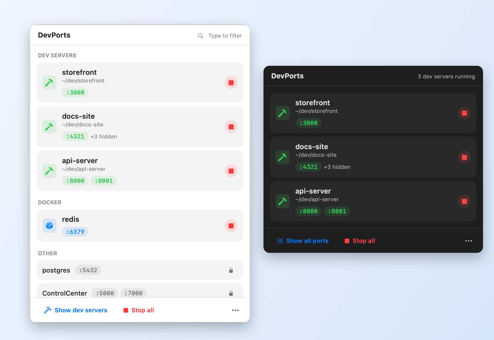

# DevPorts

A macOS menu bar app that shows which dev servers run on which ports, and stops, restarts or opens them with one click.



---

## Overview

DevPorts answers one question: what is running on my machine, and where? Click the menu bar icon (or press ⌥⌘P from any app) to see every dev server with its project folder and its ports. Open a port in the browser, stop one server, or stop all of them. A stop you regret is one click away from a restart. A second view shows every listening port, including Docker containers and system apps.

### Tech Stack

| Layer        | Technology                                                                      |
| ------------ | ------------------------------------------------------------------------------- |
| Language     | Swift 6 toolchain, Swift Package Manager (tools 5.9), macOS 14+                 |
| UI           | SwiftUI inside an AppKit `NSStatusItem` + `NSPopover`                           |
| Process data | `lsof`, `ps`, `sysctl(KERN_PROCARGS2)`, `docker ps`                             |
| System       | `SMAppService` (open at login), Carbon `RegisterEventHotKey` (global hotkey)    |
| Tests        | XCTest, with real processes started and stopped in each test                    |
| Dependencies | None                                                                            |

---

## Design Decisions

### What counts as a dev server

**The problem I was solving:** `lsof` lists 20 to 30 listening processes on a normal Mac. Most of them are system services you never want to touch.

**My approach:**

- A dev server is a process that listens on a TCP port and runs in a project folder: a folder with `package.json`, `.git`, `Cargo.toml`, `go.mod`, `pyproject.toml` or `Gemfile`.
- Processes in the same process group and folder merge into one row, so `pnpm dev` and the `node` child it starts show as one server.
- Ports above 49152 and the Node debugger ports (9229, 9230) are "hidden". A row shows the main port and a quiet "+3 hidden".
- A tool that runs inside a project folder but listens only on a random port is not a dev server. It moves to "Other".
- The default view shows only dev servers. "Show all ports" adds Docker containers and other processes. Apps that listen only on random ports are folded into one "Show 8 apps on random ports" line.

**Why I chose this approach:** the menu bar count must match what you think of as "my servers". One rule, based on the folder, gets that right without any setup.

### Stopping safely

**The problem I was solving:** a stop button next to system processes is dangerous, and killing only the parent process often leaves the real server running.

**My approach:**

- DevPorts sends SIGTERM to the whole process group, then SIGKILL after 3 seconds if the group is still alive.
- It stops a group only if the group is not DevPorts' own group, not the terminal session, and has no protected member.
- Processes under `/System`, `/usr/libexec`, `/usr/sbin`, `/sbin`, `/Applications` and `~/Library/Application Support` are protected. They show a lock with the reason instead of a stop button. (Xcode's own tools are an exception.)
- Docker rows stop the container with `docker stop`.
- "Stop all" stops only dev servers, never Docker or other processes. The first click turns into "Stop 3 dev servers?", and a second click within 3 seconds confirms.

**Why I chose this approach:** stopping must be fast for dev servers and impossible for the things that keep macOS running.

### Undo as restart

**The problem I was solving:** you stop the wrong server, and now you have to find its folder and remember its command.

**My approach:**

- Before a stop, DevPorts reads the exact argv of the process group leader with `sysctl(KERN_PROCARGS2)` and its working folder with `lsof`.
- A stopped server moves to "Recently stopped" (the last 5) with a Restart button.
- Restart runs the same command in the same folder through your login shell, so `nvm`, `pnpm` and your `PATH` work. (macOS hides other processes' environment, so it cannot be copied.)
- The row shows "Starting…", then "Running on :3000", or "Did not start" with the reason, "Open log" and "Retry".
- Each restart writes a log to `~/Library/Logs/DevPorts/<name>.log` that starts with the date, the folder and the command.
- Docker containers restart with `docker start`. Other unprotected processes restart like dev servers.

**Why I chose this approach:** a restart is an honest undo. It does not pretend to bring back the old process, and it shows the result.

### Keyboard

| Key                   | Action                                    |
| --------------------- | ----------------------------------------- |
| ⌥⌘P                   | Open DevPorts from any app                |
| ↑ ↓                   | Select a server                           |
| ↩ or double-click     | Open the main port in the browser         |
| ⌘⌫                    | Stop the selected server                  |
| Type                  | Filter by name, folder or port            |
| Esc                   | Clear the filter, or close the popover    |
| ⌘R                    | Refresh                                   |
| ⌘Q                    | Quit                                      |

The "…" menu lists these keys, so you never have to remember them.

### Other design choices

- **One action per click area:** a port chip opens the port, the folder opens Finder, the stop button stops, and the card itself selects. "Other" rows show ports as plain labels, because ports like `:5432` do not serve web pages.
- **Errors that help:** each error says what failed and why, and offers only an action that can work. A permission error offers "Copy command" with the `sudo kill` command, and never a "Try again" that would fail again.
- **Focus:** the popover opens with no focus ring (Tab still shows one), and when it closes DevPorts hides so focus goes back to the app you were using.
- **Solid background:** the popover uses the window background colour, so it reads the same on any wallpaper.
- **Open at login:** turned on at first launch with `SMAppService`, and switchable in the "…" menu.
- **Accessibility:** VoiceOver labels on every icon button and port chip, the selected row announces itself, and status is never shown by colour alone.

### Infrastructure decisions

- **Refresh:** a scan every 3 seconds, on a background task. A new scan does not start while the last one is running.
- **Timeouts:** every shell command stops after 5 seconds (30 for `docker stop`), so a Docker daemon that is starting cannot freeze the list.
- **No dependencies:** everything uses the system tools that ship with macOS.

---

## Development Journey

1. A first menu bar app with `MenuBarExtra`, replaced by `NSStatusItem` + `NSPopover` because the `MenuBarExtra` window would not shrink after "Show all ports".
2. Process-group stopping and the protected list, after a test showed that stopping `pnpm` left its `node` child running.
3. Restart from the captured argv, then through the login shell after restarts failed without `nvm` in `PATH`.
4. Hidden ports, after one Astro server showed six ports.
5. App icon, open at login, coloured footer buttons.
6. Eight design critiques with the Impeccable skill. The design health score went **25 → 28 → 31 → 32 → 34 → 40 → 38 → 40** out of 40. Each fix is its own commit.

### Decisions reconsidered

- **Card click:** first it opened the main port. A critique found that one card had four different click results, so the card click was removed. Later the card got native list behaviour: click selects, double-click opens.
- **Refresh button:** removed from the footer, because the list refreshes every 3 seconds. ⌘R and the "…" menu still refresh.
- **"Try again" on errors:** replaced with "Copy command" for permission errors, because a second try could never work.
- **A 40/40 score:** one self-review gave 40/40 too early. A fresh review found two real issues (lost focus after Esc, and the misleading "Try again"), and the score dropped to 38 until they were fixed.

### What surprised me

- `KERN_PROCARGS2` repeats `argv[0]` after the executable path, and splitting on empty strings drops empty arguments. The parser now reads exactly `argc` strings.
- `pnpm` lives in `~/Library/pnpm`, so the first version of the protected list blocked it.
- Python from Xcode runs from `/Applications/Xcode.app`, which the protected list also blocked.

---

## AI Collaboration Reflection

The app was built with Claude Code in one long session. Every change was small, built with `swift build`, checked with `swift test` and committed on its own. UI changes were checked by rendering the SwiftUI views offscreen in light and dark mode, because the session had no control of the screen.

---

## Known Limitations

- The hotkey is fixed to ⌥⌘P. If another app uses it, DevPorts does not tell you.
- "Copy command" copies `sudo kill <pid>`, which stops the main process but not its child processes.
- Restart has no keyboard shortcut yet; ⌘Z is planned.
- Restarts run through your login shell, not with the original environment variables.
- Some tools (for example `astro dev` in background mode) detach from the terminal, so the restart log shows little output.
- The app is signed ad hoc, not notarized. On another Mac, Gatekeeper asks for confirmation the first time.
- The Docker restart and the global hotkey were checked in code and tests, not with a running Docker daemon or a real key press.

---

## Running Locally

```bash
git clone <this repo>
cd devports
./build-app.sh
open DevPorts.app
```

Tests: `swift test`. They start and stop real local servers on ports 47xxx.

To redraw the app icon:

```bash
swift make-icon.swift && iconutil -c icns AppIcon.iconset -o AppIcon.icns
```
